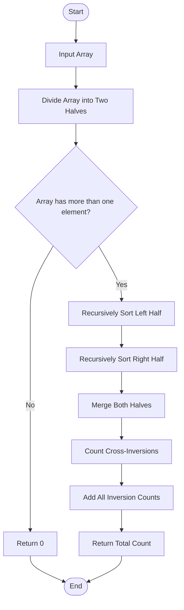

# 🔢 Count Inversions Using Merge Sort

## 📌 Problem Description

Count the number of inversions in an array. An inversion is a pair of indices `(i, j)` such that `i < j` and `arr[i] > arr[j]`.

## ⚙️ Workflow

1. Divide the array into two halves using Merge Sort.
2. Recursively count inversions in the left half.
3. Recursively count inversions in the right half.
4. Merge both halves in sorted order.
5. Count cross-inversions when an element in the right half is smaller than an element in the left half.
6. Add all inversion counts and return the final result.

## 📊 Flowchart

## 💡 Example

**Input:** `[2, 4, 1, 3, 5]`

**Output:** `3`

**Inversions:** `(2,1)`, `(4,1)`, `(4,3)`

## ⏱️ Complexity Analysis

* **Time Complexity:** `O(n log n)`
* **Space Complexity:** `O(n)`

## 🛠️ Approach

The Merge Sort algorithm efficiently counts inversions while sorting the array. When an element from the right half is smaller than an element from the left half, all remaining elements in the left half form inversions with it.
